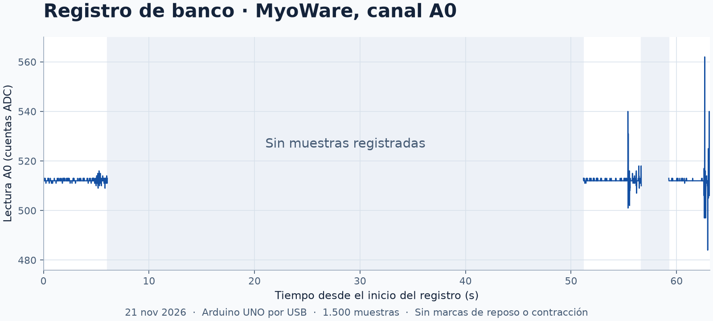
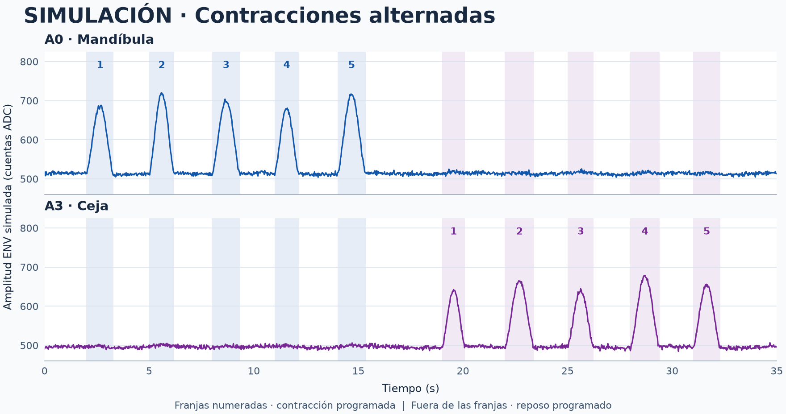

# Validar MyoWare Arduino Shield con UNO

Fecha: 2026-11-21.
La foto identifica un MyoWare 2.0 Arduino Shield DEV-18426. No demuestra funcionamiento ni permite inspeccionar los pines inferiores. No se detectó un UNO conectado al preparar esta guía. Las instrucciones y compilación apuntan al UNO R3/ATmega328P; confirmar revisión antes de cargar.

## Para qué sirve
El shield distribuye alimentación y lleva las señales de hasta seis sensores a A0–A5 del UNO. El UNO digitaliza y envía datos por USB. No mide músculos por sí solo. Para Myo permite depurar señal, calibrar una contracción voluntaria y luego convertirla en confirmación/clic de una interfaz. No identifica intenciones ni mueve el cursor sin software adicional.
Con el inventario actual hay dos Link Shields y dos cables TRS: dos canales cableados simultáneos. Para comenzar basta uno. El wearable inalámbrico final no necesita llevar el UNO encima.

## Montaje de un canal

[Ilustración del montaje con REF remoto](../../hardware/schematics/myoware-conexion-uno-ref.png) · [Capturas del sensor y del cable REF](../../hardware/schematics/README.md#conector-y-cable-ref).

Electrodos adhesivos en piel
          │
     Sensor MyoWare
          │ broches
      Link Shield
          │ TRS macho–macho
 Arduino Shield · jack A0
          │ pines apilados
        UNO R3
          │ USB
   Mac solo a batería

Usar Link Shield, NO Cable Shield para conectar al jack A0. Para el segundo canal, repetir la conexión con otro MyoWare, Link Shield y cable TRS al jack A3. Los conectores de aspecto idéntico no tienen la misma función. No añadir Wireless/Power Shield al montaje alimentado por UNO. CAB-12970 no hace falta con electrodos directamente en el sensor.

## Procedimiento
1. Sin electrodos en el cuerpo: confirmar UNO R3, comprobar que tiene pines soldados y rectos por debajo el Arduino Shield, sin puentes de soldadura. La marca 5V/GND/A0 de ambos debe coincidir al apilar; no desplazar una posición.
2. Comprobar el UNO solo con el ejemplo Blink del IDE. Seleccionar Arduino Uno y el puerto real. Así se separan problemas de USB/carga de los del sensor.
3. Desconectar USB antes de montar el shield y de insertar/quitar TRS. En UNO R3 se usa el jumper PWR de 5V de fábrica; no hace falta modificarlo. Si el jumper fue modificado, inspeccionarlo antes de alimentar.
4. Apilar Link Shield sobre sensor, conectar TRS a A0. Seleccionar OUTPUT=ENV si el Link dispone de selector; encender su interruptor al usarlo. Consultar etiquetas/manual de la revisión real.
5. Cargar ../../firmware/myoware_a0/myoware_a0.ino sin electrodos adheridos al cuerpo. Abrir Serial Plotter a 115200 baudios o el [monitor local](../../software/myoware-monitor/README.md), no ambos a la vez. Un pin sin sensor puede fluctuar: no es una prueba de fallo ni de actividad muscular.
6. Antes de adherir electrodos, usar la Mac a batería y desconectar cargador, docks, monitores y otros periféricos conectados a la red. SparkFun recomienda un aislador USB para reducir ruido y riesgo eléctrico; si no se dispone de uno, su alternativa es portátil a batería sin conexión a la red. No usar un cargador USB de pared en la cadena conectada al cuerpo.
7. Colocar electrodos según la guía oficial, empezando con un músculo fácil de contraer como bíceps. No empezar probando en la frente. Mantener postura/cables estables; registrar reposo y cinco contracciones suaves separadas por relajación.
8. En UNO R3, ENV se representa en cuentas ADC 0–1023: debe aumentar de forma repetible al contraer y bajar al relajar. No existe un valor fijo universal; no son newtons ni porcentaje clínico de fuerza. Una señal pegada a 0/1023, o que solo cambia al mover el cable, requiere revisar alimentación, contacto, colocación y saturación.
9. Con ambos sensores en ENV, probar una contracción a la vez: al activar A0, comprobar que A3 siga cerca del reposo; luego invertir la prueba. Si hay problemas, cambiar solo una pieza cada vez (cable, sensor o Link). Validar A0 y A3 no certifica los otros jacks.

## Criterio de prueba de banco
Anotar valores de reposo y contracción de cinco intentos; si la elevación coincide repetidamente con la contracción y vuelve al reposo, queda probada la cadena de ese canal para una demo inicial. Después probar movimientos sin contracción intencional para detectar falsos disparos. No afirmar validación clínica ni clasificación de gestos por esta prueba.

## Siguiente paso de producto
Primero señal reproducible → después umbral individual con histéresis y tiempo mínimo → después una acción de confirmar en pantalla. Medir aciertos, falsos clics y comodidad. Diseñar la carcasa 3D solo tras decidir músculo y posición, dejando electrodos accesibles y cables sin tensión.

## Fuentes oficiales
- https://www.sparkfun.com/myoware-2-0-arduino-shield.html
- https://learn.sparkfun.com/tutorials/getting-started-with-the-myoware-20-muscle-sensor-ecosystem/all
- https://myoware.com/wp-content/uploads/2022/03/MyoWare_v2_QuickStartGuide.pdf

## Registro real del canal A0

El 21 de noviembre de 2026 se detectó por USB un Arduino UNO con firma ATmega328P (`1E 95 0F`). Se compiló y cargó el firmware (1.902 bytes de flash y 192 bytes de RAM). Del monitor se recuperaron **1.500 muestras** del canal A0 que cubren **63,2 s** de tiempo transcurrido, con dos intervalos sin datos. El rango fue de **484 a 562 cuentas ADC**.

El registro documenta la llegada de lecturas al monitor. La captura solo incluye A0 y carece de marcas de reposo y contracción. Queda pendiente comprobar que los cambios coincidan con cada gesto y verificar ambos canales en una misma sesión.

## Ejemplo simulado de contracciones

La figura usa **datos sintéticos** para mostrar cómo se documentaría la prueba. Hay cinco contracciones programadas por canal, primero en A0 (mandíbula) y luego en A3 (ceja). Las franjas sombreadas marcan los intentos. Fuera de esas franjas se simula el reposo.

Para la próxima captura, marca el inicio y el fin de cada intento y exporta ambos canales desde el monitor. En la gráfica compara si la señal del canal objetivo sube durante el gesto, baja después y cuánto cambia el otro canal. Registra también cualquier activación involuntaria durante el reposo. [Monitor MyoWare y exportación CSV](../../software/myoware-monitor/README.md#qué-muestra).
