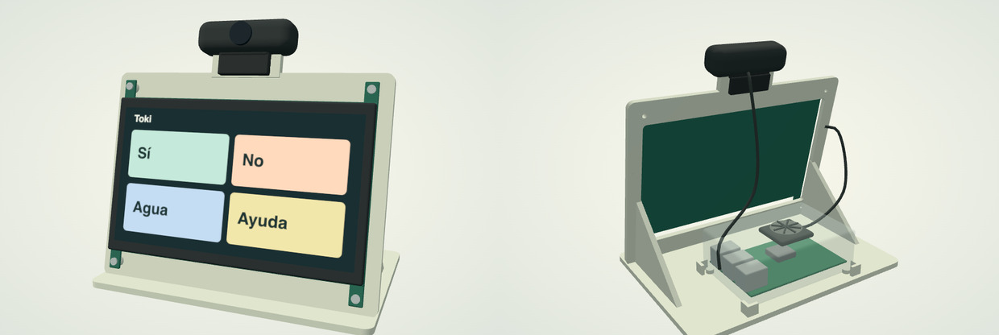

# Impresión 3D de Toki

## Consola de mesa

El soporte de una pieza reúne un marco inclinado para la pantalla táctil, una pestaña superior de **45 × 5 mm** para el clip de la webcam y cuatro guías en la base para el case de la Raspberry Pi 4. La electrónica se instala después de la impresión.



[STL del soporte](consola-7/soporte.stl) · [Fuente en OpenSCAD](consola-7/soporte.scad) · [Plantilla de comprobación a escala real](../raspberry/plantilla-montaje-7in.html)

- **En el laminador.** Importar en mm al 100 %, una unidad, con la base plana en la cama. La pieza ocupa **180 × 131 × 146,46 mm**. Revisar en la vista por capas el puente del travesaño superior antes de configurar los soportes según la impresora.
- **Antes de imprimir.** Comparar el panel con la plantilla A4 al 100 %. El modelo toma como referencia los cuatro centros a **156,90 × 114,96 mm** del [LCDWiki MPI7002](https://www.lcdwiki.com/res/MPI7002/MPI7002_Size.pdf) y el case [Vilros VILP014](https://vilros.com/products/vilros-raspberry-pi-4-compatible-clear-transparent-case-with-built-in-fan) de **92,6 × 63,4 × 32,5 mm**. Falta verificar en el equipo real el patrón, el agarre de la webcam y la salida de los cables.
- **Visor 3D.** Tras clonar el repositorio, abrir [consola-7/index.html](consola-7/index.html) en un navegador con WebGL. Las vistas «Frente», «Reverso» y «Solo soporte» usan el STL incluido. También se puede servir desde la raíz:

```sh
python3 -m http.server 8267 --bind 127.0.0.1 --directory hardware/3d/consola-7
```

Abrir [el visor local](http://127.0.0.1:8267/). Para regenerar el visor tras editar el STL, desde su carpeta con Three.js 0.187.0 y esbuild 0.28.2 instalados, ejecutar `esbuild app.js --bundle --loader:.stl=binary --minify --outfile=visor.js`.

## Brazalete Toki para Arduino Uno y Xiaomi PB2067

Imprimir una unidad de cada STL. Importar en milímetros, a escala del 100 % y en la orientación guardada.

| Pieza | STL | Fuente editable | Medidas exteriores (X × Y × Z) |
|---|---|---|---|
| Caja abierta para Uno R3 + MyoWare | [bandeja-uno.stl](brazalete-pb2067/bandeja-uno.stl) | [OpenSCAD](brazalete-pb2067/bandeja-uno.scad) | 82,18 × 66,94 × 34,40 mm |
| Bolsillo de inserción superior para Xiaomi PB2067 | [bolsillo-xiaomi.stl](brazalete-pb2067/bolsillo-xiaomi.stl) | [OpenSCAD](brazalete-pb2067/bolsillo-xiaomi.scad) | 78,80 × 43,80 × 108,20 mm |


### En el laminador

- **Caja del Uno.** Apoyar el dorso plano sobre la cama, con las pestañas hacia arriba. Revisar los puentes sobre las ventanas de los conectores y sobre el túnel de la correa. El túnel tiene 3,2 mm de alto. Evitar soportes que queden atrapados dentro.
- **Bolsillo.** Apoyar el fondo cerrado sobre la cama y dejar la boca hacia arriba. El hueco interior mide 74 × 33,2 mm y tiene 105 mm de profundidad. La batería se sostiene por gravedad con la boca hacia arriba.
- **Correa.** Ambas piezas admiten un extremo libre de una correa de 30 × 2 mm nominales. Si la real difiere, ajustar los parámetros en los dos archivos OpenSCAD y volver a exportar.

### Comprobación antes de usar

Ambos STL se comprobaron como sólidos cerrados de un componente. Queda pendiente la prueba física: pasar la correa, comprobar las pestañas con el Uno y los cables enchufados, e introducir y retirar la batería sobre una mesa. Comprobar que sus 415 g no hacen girar el conjunto antes de llevarlo en el brazo.
