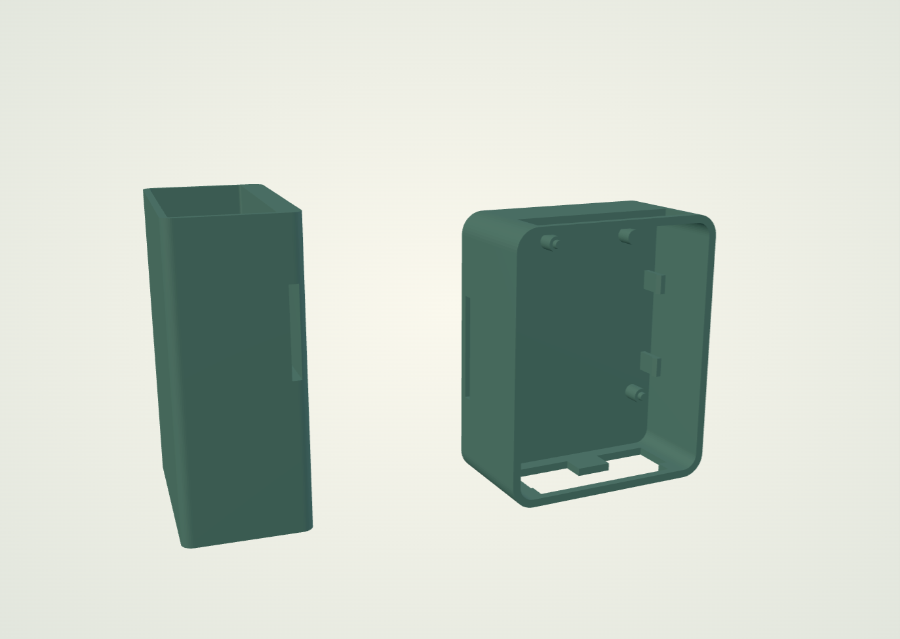

# Brazalete Toki para Arduino Uno y Xiaomi PB2067

Imprimir una unidad de cada STL. Importar en milímetros, a escala del 100 % y en la orientación guardada.

| Pieza | STL | Fuente editable | Medidas exteriores (X × Y × Z) |
|---|---|---|---|
| Caja abierta para Uno R3 + MyoWare | [bandeja-uno.stl](brazalete-pb2067/bandeja-uno.stl) | [OpenSCAD](brazalete-pb2067/bandeja-uno.scad) | 82,18 × 66,94 × 34,40 mm |
| Bolsillo de inserción superior para Xiaomi PB2067 | [bolsillo-xiaomi.stl](brazalete-pb2067/bolsillo-xiaomi.stl) | [OpenSCAD](brazalete-pb2067/bolsillo-xiaomi.scad) | 78,80 × 43,80 × 108,20 mm |

## En el laminador

- **Caja del Uno.** Apoyar el dorso plano sobre la cama, con las pestañas hacia arriba. Revisar los puentes sobre las ventanas de los conectores y sobre el túnel de la correa. El túnel tiene 3,2 mm de alto. Evitar soportes que queden atrapados dentro.
- **Bolsillo.** Apoyar el fondo cerrado sobre la cama y dejar la boca hacia arriba. El hueco interior mide 74 × 33,2 mm y tiene 105 mm de profundidad. La batería se sostiene por gravedad con la boca hacia arriba.
- **Correa.** Ambas piezas admiten un extremo libre de una correa de 30 × 2 mm nominales. Si la real difiere, ajustar los parámetros en los dos archivos OpenSCAD y volver a exportar.

## Comprobación antes de usar

Ambos STL se comprobaron como sólidos cerrados de un componente. Queda pendiente la prueba física: pasar la correa, comprobar las pestañas con el Uno y los cables enchufados, e introducir y retirar la batería sobre una mesa. Comprobar que sus 415 g no hacen girar el conjunto antes de llevarlo en el brazo.
