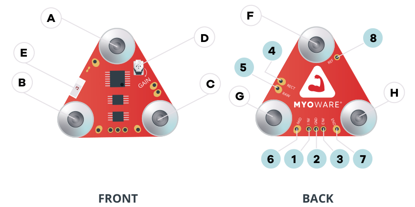
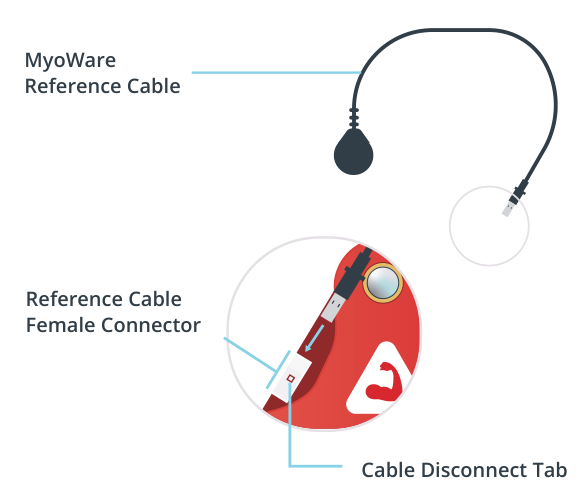

# Ilustraciones de conexión

Las ilustraciones del prototipo explican los componentes y el orden de conexión. Las figuras de la guía avanzada muestran los detalles del sensor y del cable.

- `myoware-componentes.png`: separa Muscle Sensor, Link Shield y Cable Shield.
- [Conexión MyoWare → UNO con REF remoto](myoware-conexion-uno-ref.png). La ilustración muestra el apilamiento, el cable negro de REF y la cadena hasta la Mac. En la placa real identifica el jack por su rótulo **A0**. Para ver una captura de las lecturas, consulta el [registro de banco](../../docs/validation/MYOWARE.md#registro-real-del-canal-a0).
- `myoware-biceps.png`: orientación conceptual de MID/END/REF; no a escala. No inferir distancias ni orientación por el contorno dibujado del sensor: seguir las etiquetas físicas.

Se excluyeron las primeras imágenes que añadían cables de electrodos innecesarios o mostraban las placas separadas sobre el brazo.

Referencia autoritativa de colocación: https://myoware.com/wp-content/uploads/2022/03/MyoWare_v2_QuickStartGuide.pdf
Referencia de conexiones: https://learn.sparkfun.com/tutorials/getting-started-with-the-myoware-20-muscle-sensor-ecosystem/all

## Conector y cable REF

La figura del fabricante identifica el **puerto lateral REF (E)** en el frente. En el reverso están los broches integrados **REF (F)**, **MID (G)** y **END (H)**.

El cable de referencia lleva un broche en un extremo y un pequeño terminal en el otro. El terminal encaja en el puerto lateral del sensor. El broche REF integrado sigue activo al insertar el cable, según el fabricante.

*Recortes de las figuras del fabricante.* [Guía avanzada MyoWare 2.0, Advancer Technologies](https://myoware.com/wp-content/uploads/2022/03/MyoWare_v2_AdvancedGuide-Updated.pdf).
